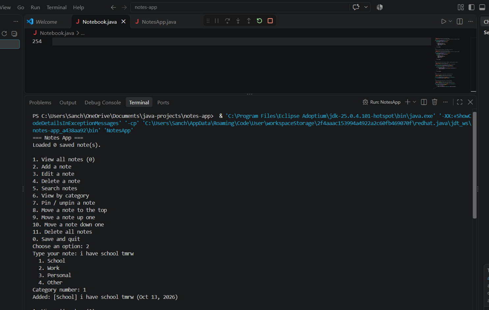

# Notes App

A Java console notes app (a CRUD app) that started as a class assignment. Add, view, edit, delete, search, and organize notes, and they're saved to a file so they're still there next time.

## Features
- Create, read, update, and delete notes
- Categories (School, Work, Personal, Other) with a view-by-category option
- A date on every note
- Pin important notes so they always stay on top
- Search, reorder, and delete all (with a confirm step)
- Notes saved to notes.txt and loaded back on startup

## Java concepts used
Classes and objects, ArrayList, Scanner menus, switch, string methods, LocalDate, try/catch, and file I/O

## How to run
1. Download `Notebook.java` and `NotesApp.java` into one folder
2. Run `javac *.java`
3. Run `java NotesApp`

## What I'd add next
- Rebuild it with Spring Boot and a database so people can share notes
- A website front end

